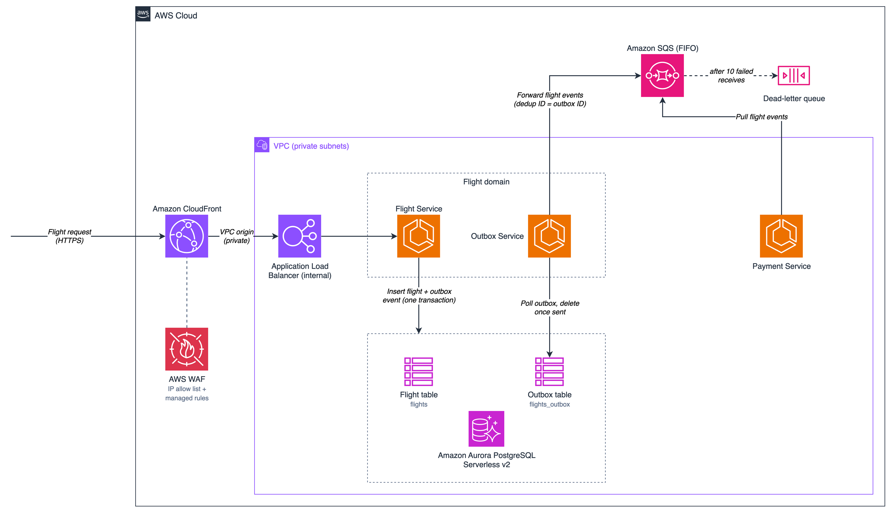
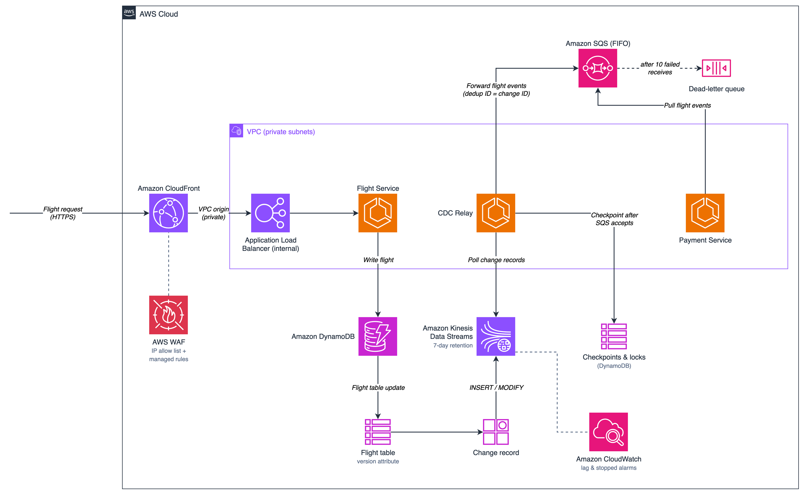

# Transactional Outbox Pattern Sample

## Intent

The transactional outbox pattern resolves the dual write operations issue that occurs in distributed systems when a single operation involves both a database write operation and a message or event notification. A dual write operation occurs when an application writes to two different systems; for example, when a microservice needs to persist data in the database and send a message to notify other systems. A failure in one of these operations might result in inconsistent data.

Blog reference: https://docs.aws.amazon.com/prescriptive-guidance/latest/cloud-design-patterns/transactional-outbox.html 

## Motivation

When a microservice sends an event notification after a database update, these two operations should run atomically to ensure data consistency and reliability.
- If the database update is successful but the event notification fails, the downstream service will not be aware of the change, and the system can enter an inconsistent state.
- If the database update fails but the event notification is sent, data could get corrupted, which might affect the reliability of the system.

## Applicability

Use the transactional outbox pattern when:
- You're building an event-driven application where a database update initiates an event notification.
- You want to ensure atomicity in operations that involve two services.
- You want to implement the event sourcing pattern.

## Issues and Considerations

Issues and considerations
- Duplicate messages: The events processing service might send out duplicate messages or events, so we recommend that you make the consuming service idempotent by tracking the processed messages.
- Order of notification: Send messages or events in the same order in which the service updates the database. This is critical for the event sourcing pattern where you can use an event store for point-in-time recovery of the data store. If the order is incorrect, it might compromise the quality of the data. Eventual consistency and database rollback can compound the issue if the order of notifications isn't preserved.
- Transaction rollback: Do not send out an event notification if the transaction is rolled back.
- Service-level transaction handling: If the transaction spans services that require data store updates, use the saga orchestration pattern to preserve data integrity across the data stores.

## Implementation

We will look at two ways of implementing this pattern: one leveraging a traditional relational database with an outbox table, and one leveraging a NoSQL database that natively supports real-time change data capture (CDC).

Both implementations expose their API through [Amazon CloudFront](https://aws.amazon.com/cloudfront/) (HTTPS, protected by an [AWS WAF](https://aws.amazon.com/waf/) IP allow list) in front of an **internal** [Application Load Balancer](https://aws.amazon.com/elasticloadbalancing/) reached through a CloudFront VPC origin, and run on [Amazon ECS](https://aws.amazon.com/ecs/) with AWS Fargate.

Each implementation publishes its events to its own Amazon SQS FIFO queue (with a dead-letter queue), consumed by its own simulated payment service.

The outbox implementation leverages [Amazon Aurora PostgreSQL Serverless v2](https://aws.amazon.com/rds/aurora/) and [Amazon SQS](https://aws.amazon.com/sqs/) and will lead you to provision the following infrastructure:



The CDC implementation leverages [Amazon DynamoDB](https://aws.amazon.com/dynamodb/) and [Amazon Kinesis Data Streams](https://aws.amazon.com/kinesis/data-streams/) and will lead you to provision the following infrastructure:



### Prerequisites

- An [AWS](https://aws.amazon.com/) account.
- An AWS user with AdministratorAccess (see the [instructions](https://console.aws.amazon.com/iam/home#/roles%24new?step=review&commonUseCase=EC2%2BEC2&selectedUseCase=EC2&policies=arn:aws:iam::aws:policy%2FAdministratorAccess) on the [AWS Identity and Access Management](http://aws.amazon.com/iam) (IAM) console).
- Access to the following AWS services: Amazon CloudFront, AWS WAF, Elastic Load Balancing, Amazon ECS, Amazon Aurora, Amazon SQS, Amazon DynamoDB and Amazon Kinesis Data Streams.
- [Docker](https://docs.docker.com/engine/install/), [Java 21](https://docs.aws.amazon.com/corretto/latest/corretto-21-ug/downloads-list.html) and [Node.js 22 or later](https://nodejs.org/en) installed.
- Docker will be used to build the container images - make sure your daemon is running. Type `docker ps` and if you see an error such as `Cannot connect to the Docker daemon` it means Docker is installed but not running.
- The container images are built for **ARM64** (AWS Graviton). On an x86 machine, Docker needs ARM64 emulation (for example `docker run --privileged --rm tonistiigi/binfmt --install arm64` with Docker Buildx); Docker Desktop on Apple silicon works out of the box.

> **NOTE:** For the sake of simplicity and readability, all services run in the same container. As your application grows in features, usage and complexity, it is considered best practice to run services of different domains in their own containers. It allows you to scale them independently and to more easily make changes without impacting other areas of your application.

### Deploy using CDK

#### Step 1: Download the application

```shell
git clone https://github.com/aws-samples/transactional-outbox-pattern.git
```

#### Step 2: Initialize your CDK environment and deploy the shared resources

The `cdk.json` file tells the CDK Toolkit how to execute your app. Every `cdk` command needs the IPv4 address allowed to call the APIs, passed as the `allowedCidr` context value. Replace `<MY_PUBLIC_IP>` with the public IP you will use to access the application (you can find it through websites such as https://checkip.amazonaws.com/).

The application stacks are deployed to your AWS profile's default Region. If your profile has no default Region, add `-c region=<REGION>` to every `cdk` command (likewise `-c account=<ACCOUNT_ID>` if the account cannot be determined).

The WAF web ACL used by CloudFront must be created in `us-east-1`, so bootstrap both `us-east-1` and the Region you deploy the application to:

```shell
cd transactional-outbox-pattern/infra
npm ci
npx cdk bootstrap aws://<ACCOUNT_ID>/us-east-1 aws://<ACCOUNT_ID>/<REGION>
npx cdk deploy EdgeSecurityStack BaseStack -c allowedCidr=<MY_PUBLIC_IP>/32
```
After about 5-10 mins, the deployment will complete.

> **NOTE:** The allow list is IPv4 only, so the CloudFront distributions have IPv6 disabled; use the IPv4 address reported by https://checkip.amazonaws.com.

> **TIP:** If your network egress uses several public IPs (common behind corporate proxies/VPNs), pass them as a comma-separated list: `-c allowedCidr=<IP_1>/32,<IP_2>/32`.

> **TIP:** To avoid repeating `-c allowedCidr=...`, create a `cdk.context.json` file in the `infra` folder containing `{ "allowedCidr": "<MY_PUBLIC_IP>/32" }` (this file is git-ignored).

> **NOTE:** If your public IP changes and you lose access to the application (CloudFront returns `403 ERROR - Request blocked`), redeploy with the new value (`npx cdk deploy EdgeSecurityStack -c allowedCidr=<NEW_IP>/32`), or update the IP set directly in the AWS Console: navigate to WAF & Shield, click on IP sets in the left panel and select the **Global (CloudFront)** region.

> **NOTE:** This is a sample. API calls go through CloudFront over HTTPS using the default `*.cloudfront.net` certificate; there is no authentication beyond the WAF IP allow list. The stacks are designed to be destroyed and redeployed rather than upgraded in place.

### Usage

#### Outbox implementation

> Please refer to the following [README](outbox-implementation/README.md) for detailed instructions.

#### CDC implementation

> Please refer to the following [README](cdc-implementation/README.md) for detailed instructions.

#### Cleaning Up

After destroying the implementation stack(s), type the following command to destroy the remaining resources:
```shell
npx cdk destroy BaseStack EdgeSecurityStack -c allowedCidr=<MY_PUBLIC_IP>/32
```

> **NOTE:** Destroying the `AuroraStack` keeps a final snapshot of the database cluster. Delete it from the RDS console if you no longer need it.

## Security

See [CONTRIBUTING](CONTRIBUTING.md#security-issue-notifications) for more information.

## License

This library is licensed under the MIT-0 License. See the LICENSE file.
