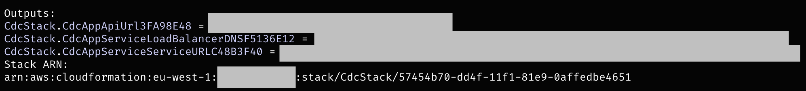
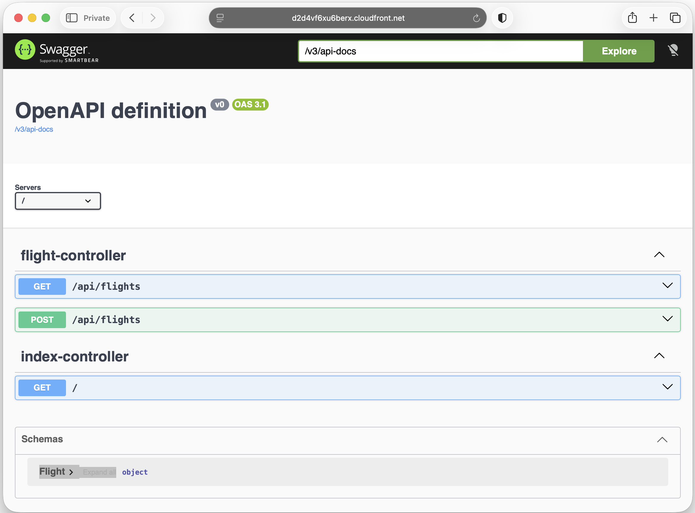
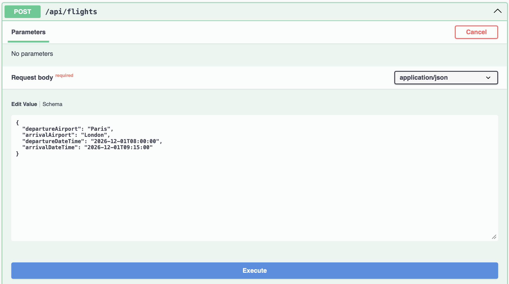
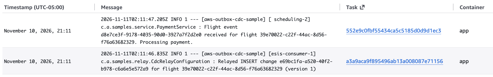
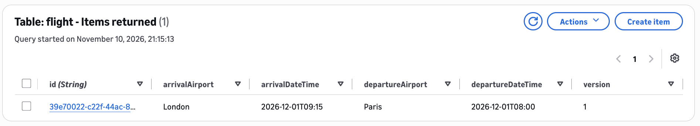

# CDC Implementation

## Deploy the CDK code

From the `infra` folder:

```shell
npx cdk deploy CdcStack -c allowedCidr=<MY_PUBLIC_IP>/32
```
After about 10-15 mins (the CloudFront distribution takes a few minutes to deploy), the deployment will complete and the HTTPS API URL (`ApiUrl` output, `https://<id>.cloudfront.net`) will be printed.


## Happy Path

1. Append `/swagger-ui/index.html` to the API URL to access the Swagger page in your browser:



2. Let's book a first flight ticket from Paris to London (you can replace the departure, destination and dates/times as you desire):
```json
{
    "departureAirport": "Paris",
    "arrivalAirport": "London",
    "departureDateTime": "2026-12-01T08:00:00",
    "arrivalDateTime": "2026-12-01T09:15:00"
}
```


After a few seconds, the flight event is processed by the Payment service.

3. To view the logs, navigate to the `Elastic Container Service` page of the AWS Console. - Click on `Clusters` in the left pane and then click on the Cluster you just deployed.

4. In the `Services` tab, click on the service you just created and then navigate to the `Logs` tab. If you have trouble finding the relevant log line, you can use the search box to filter for `Processing payment`.



5. To view the flight item in the DynamoDB Table, navigate to the `DynamoDB` page, click on `Tables` in the left pane and then click on the `flight` table in the center of your screen. Then, click on the `Explore table items` button.

 

6. Because the change records are kept in the Kinesis stream for 7 days, the relay is resilient to SQS outages by design: a Kinesis record is only checkpointed after it has been delivered to SQS. If SQS is unavailable, the relay keeps retrying the same record (preserving order) until SQS recovers. The DynamoDB change record ID is used as the SQS FIFO deduplication ID, so Kinesis redeliveries are discarded by SQS. Deletions (`REMOVE`), malformed records and messages SQS permanently rejects are logged and skipped. Two CloudWatch alarms watch the relay: `RelayLagAlarm` fires when the oldest unrelayed record is more than 1 hour old (well within the 7-day retention window), and `RelayStoppedAlarm` fires when the relay stops polling the stream. The relay reads one record per poll so that the lag alarm is exact; see `application.properties` to trade precision for throughput.

> **NOTE:** Kinesis Data Streams for DynamoDB can deliver changes for the same item out of order (and more than once). Each flight therefore carries a `version` attribute, incremented by DynamoDB on every write and included in the event: consumers should ignore an event whose version is not newer than the last one they processed for that flight.

> **NOTE:** The relay uses the Kinesis binder in polling (non-KCL) mode. Its checkpoints and shard locks are stored in two DynamoDB tables created by the `CdcStack`; all ECS tasks share one consumer group, so each record is relayed by one task.

## Cleaning Up

Run the following command to destroy the resources:

From the `infra` folder:

```shell
npx cdk destroy CdcStack -c allowedCidr=<MY_PUBLIC_IP>/32
```
