# Outbox Implementation

## Deploy the CDK code

From the `infra` folder:

```shell
npx cdk deploy AuroraStack -c allowedCidr=<MY_PUBLIC_IP>/32
```
After about 10-15 mins (the CloudFront distribution takes a few minutes to deploy), the deployment will complete and the HTTPS API URL (`ApiUrl` output, `https://<id>.cloudfront.net`) will be printed.
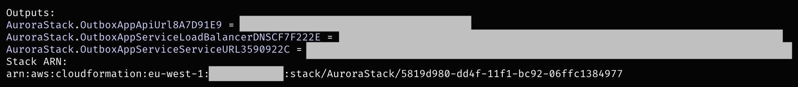

## Happy Path

1. Append `/swagger-ui/index.html` to the API URL to access the Swagger page in your browser:

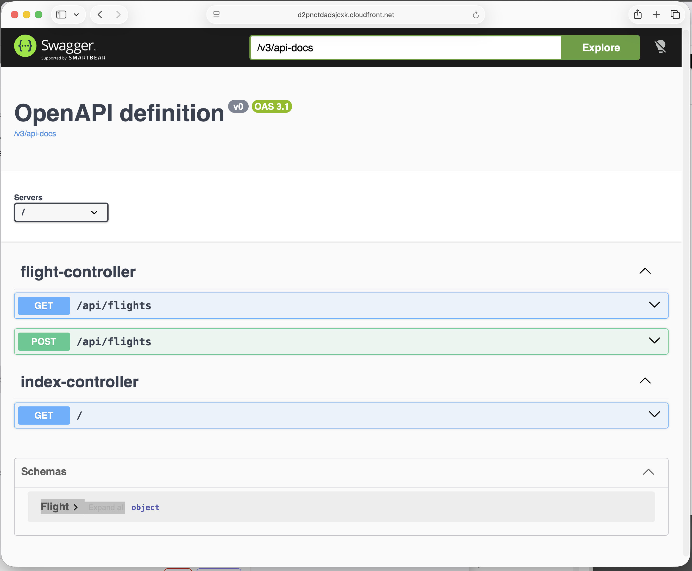

2. Let's book a first flight ticket from Paris to London (you can replace the departure, destination and dates/times as you desire):
```json
{
    "departureAirport": "Paris",
    "arrivalAirport": "London",
    "departureDateTime": "2026-12-01T08:00:00",
    "arrivalDateTime": "2026-12-01T09:15:00"
}
```
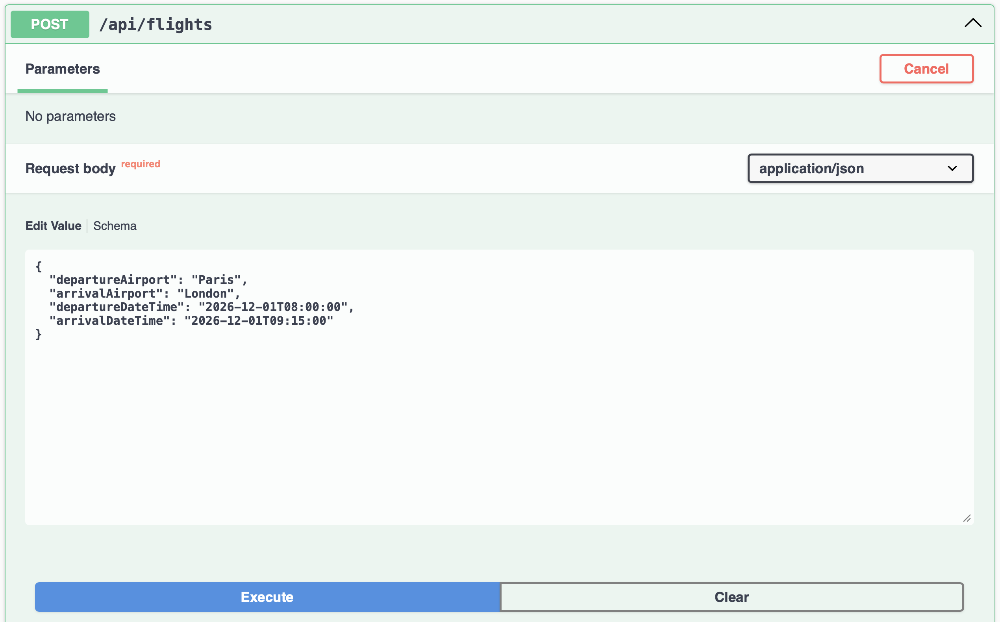

After a few seconds, the flight event is processed by the Payment service.

3. To view the logs, navigate to the `Elastic Container Service` page of the AWS Console. - Click on `Clusters` in the left pane and then click on the Cluster you just deployed.

4. In the `Services` tab, click on the service you just created and then navigate to the `Logs` tab. If you have trouble finding the relevant log line, you can use the search box to filter for `Processing payment`.

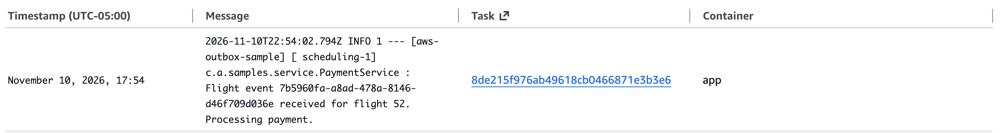

5. The flight has been recorded in the database (refer to [this](#viewing-tables) for the steps required to view tables):

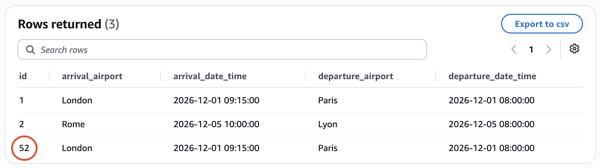

6. And because the flight booking has been processed successfully, the Outbox table is empty:

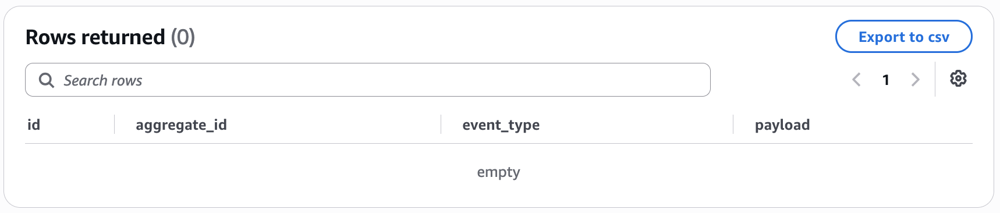

This was the happy path - everything went according to plan. Now let's look at what happens when something fails - in that case we will simulate an SQS failure and observe what happens.

## SQS Failure

1. For the sake of this example, we will remove the permissions for ECS to write to SQS:
    - Navigate to the `IAM` page in the AWS Console, the click on `Roles` in the left pane. Search for the task role that was created during deployment (it should look something like `AuroraStack-TaskRolexxx`) and click on it.
    - Click on the `TaskRoleDefaultPolicy` policy and then the `Edit` button.
    - Change the effect from `Allow` to `Deny` and then click on `Next`.
    - Click on `Save Changes`
    - Wait about a minute for the IAM change to propagate before the next step. Otherwise the event may still be delivered.

2. Navigate back to the Swagger page, and book a second flight ticket (you can replace the departure, destination and dates/times as you desire):
```json
{
    "departureAirport": "Paris",
    "arrivalAirport": "London",
    "departureDateTime": "2026-12-02T08:00:00",
    "arrivalDateTime": "2026-12-02T09:15:00"
}
```

**Request**
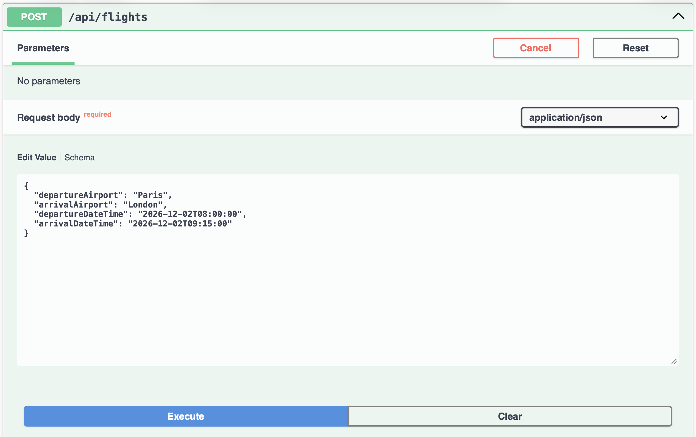

**Response**
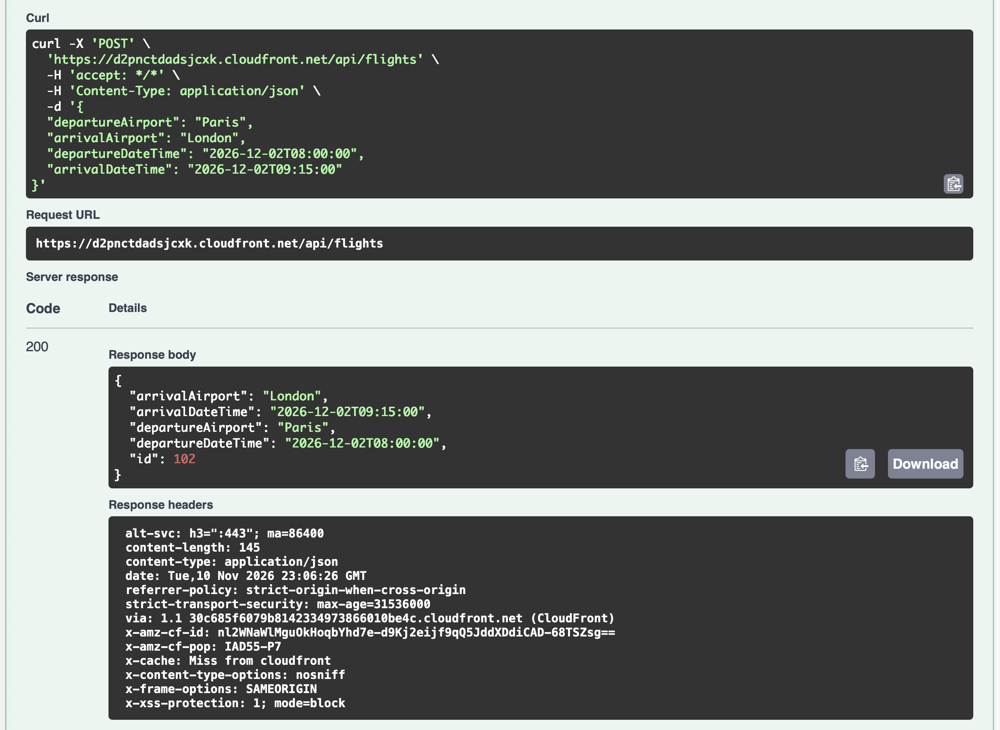

3. The booking still succeeds: the flight and its outbox event are committed in the same database transaction. Publishing happens asynchronously, and the outbox relay now logs an error because it is not allowed to send to the queue (filter the service logs for `not authorized to perform: sqs:sendmessage`).

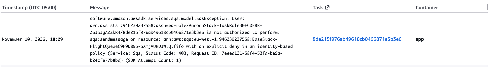

4. The event will remain in the outbox because the system has been unable to fully process the flight booking.

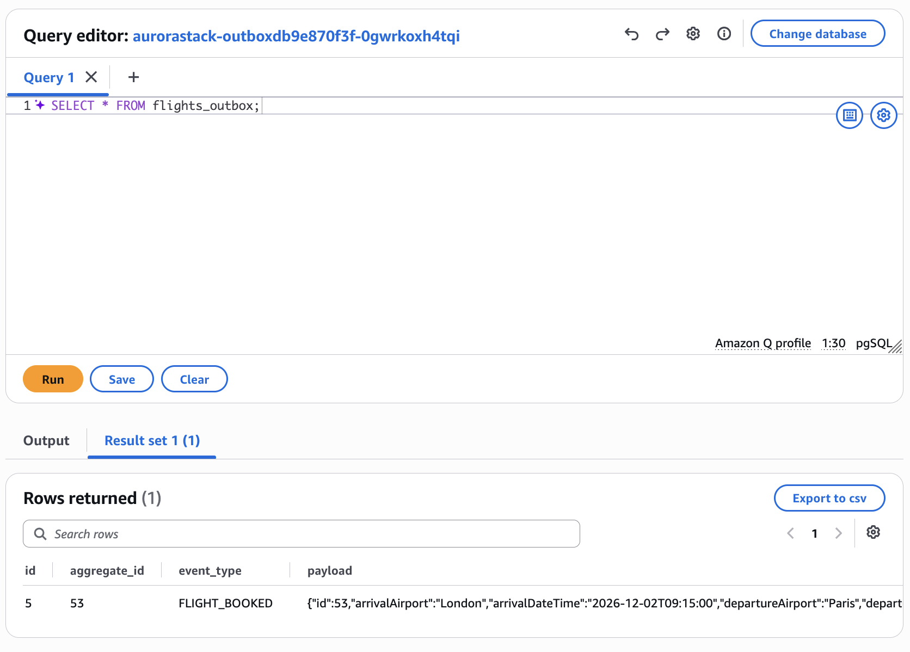

5. The relay retries with exponential backoff and keeps polling the outbox: restore the `Allow` effect on the policy and the event is delivered on the next poll (look for `Processing payment` in the logs, and the outbox table is empty again). Events that SQS rejects individually in a batch also stay in the outbox until they are accepted. Delivery is at-least-once; the outbox row ID is used as the SQS FIFO deduplication ID.

## Cleaning up

Run the following command to destroy the resources:

From the `infra` folder:

```shell
npx cdk destroy AuroraStack -c allowedCidr=<MY_PUBLIC_IP>/32
```

## Viewing tables

1. To view the content of both the Flight and the Outbox tables, navigate to the `RDS` page of the AWS Console.
2. Click on `Databases` in the left pane and then click on the cluster you just created.
3. Click on the `Action` button in the top-right corner and then on the `Query` action.

Note: The first time you do so, the Console will ask you for the credentials:
* Choose the relevant cluster in the drop down box (its name starts with `aurorastack-outboxdb`)
* Choose **Connect with a Secrets Manager ARN** and paste the ARN of the database secret generated by CDK: navigate to the `Secrets Manager` page of the AWS Console, open the secret whose name starts with `AuroraStackOutboxDbSecret` and copy its **Secret ARN** (the full ARN is required, not the name)
* Insert the database name that you have defined in the CDK file (if you have not changed it, the default is `outboxPattern`)

The tables are `flights` and `flights_outbox`, for example `SELECT * FROM flights_outbox;`.

Example:
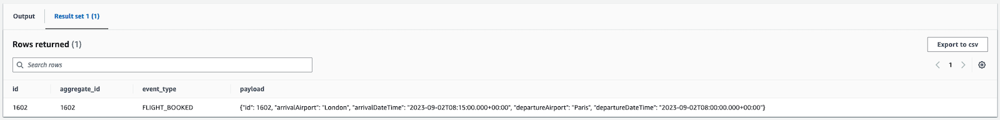

